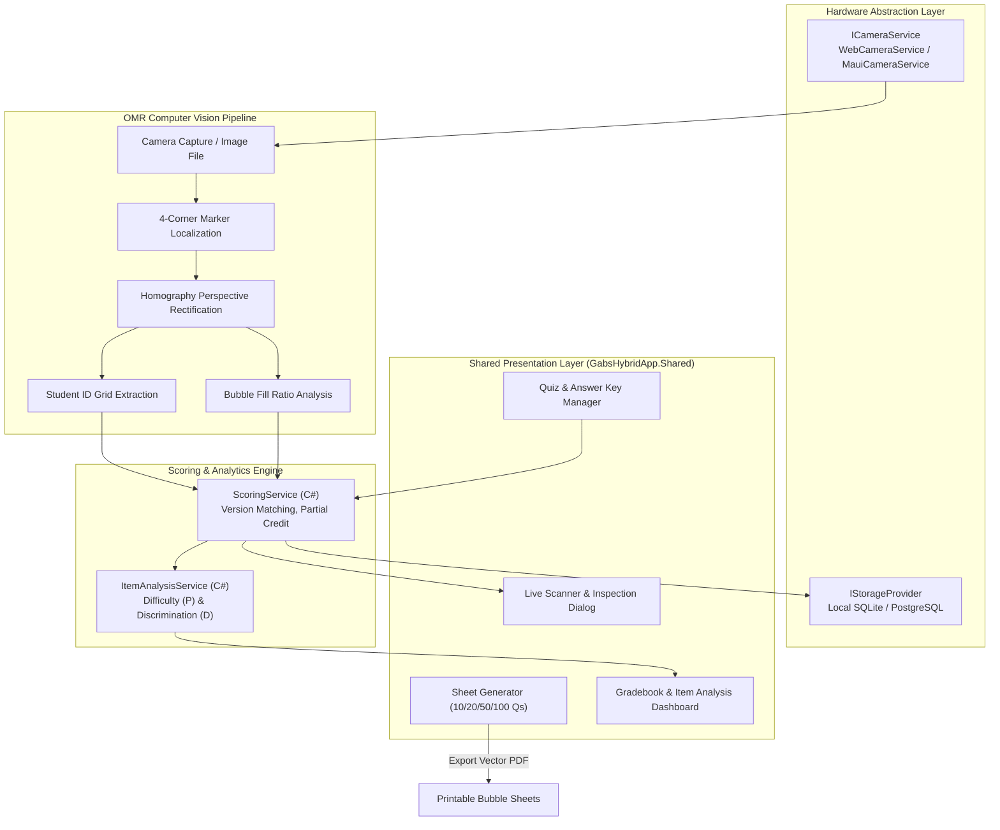
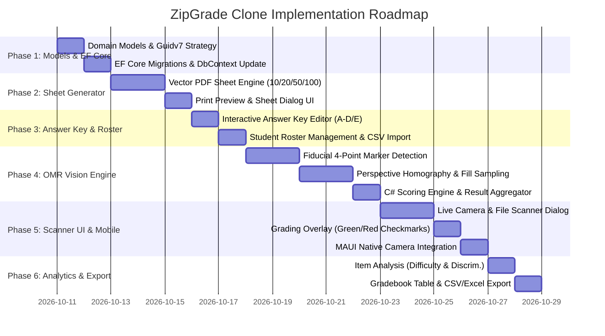

# ZipGrade Clone - Blazor Hybrid & Web Implementation Plan

## 1. Executive Summary

The objective is to implement a high-performance, offline-capable **ZipGrade Clone** within the existing **.NET 10 Blazor Hybrid & Web** architecture (**MudBlazor 9**, **ASP.NET Core Web**, and **.NET MAUI** for Android & Windows). 

This system empowers teachers and educators to:
1. **Generate and Print Standardized Bubble Sheets** (10, 20, 50, and 100 questions) formatted with 4-corner fiducial alignment markers and student ID grids.
2. **Scan Answer Sheets Instantly** using mobile phone cameras (MAUI Android), webcams, or batch document photo uploads (Web & Desktop).
3. **Execute Client-Side Optical Mark Recognition (OMR)** with perspective correction (homography warp), adaptive thresholding, and bubble fill-ratio sampling.
4. **Automatically Score Submissions** against dynamic answer keys (points weighting, multiple correct answers, alternate exam versions).
5. **View Instant Item Analysis and Gradebook Metrics** (receipt-card mobile views, difficulty index, discrimination index, CSV exports).
6. **Operate Offline-First** in classroom environments via MAUI SQLite with automatic cloud/server synchronization.

---

## 2. System Architecture



---

## 3. Core Functional Modules

### Module 1: Printable Vector Answer Sheet Generator
- **Supported Layouts**:
  - **10 Questions** (Bell-ringers, exit tickets, 5-minute quizzes; 2 or 4 sheets per page to conserve paper).
  - **20 Questions** (Weekly quizzes, unit checks).
  - **50 Questions** (Midterms, periodic exams).
  - **100 Questions** (Final exams, standardized tests).
- **Sheet Architecture**:
  - **4 Black Fiducial Corner Targets**: High-contrast solid squares used by the computer vision engine to rectify angular tilt, rotation, and lens distortion.
  - **Header Region**: Test Title, Teacher, Subject, Date, Class Section, Student Name.
  - **Student ID Grid**: 5-digit or 6-digit bubble grid (columns 0–9) for automatic student roster matching.
  - **Exam Version Marker**: 2-bubble or 4-bubble key identifier (Keys A, B, C, D) to prevent cheating.
  - **Question Bubble Columns**: Circular bubbles labeled A, B, C, D (or A–E) positioned on fixed relative coordinate grids.
- **Output Formats**:
  - High-resolution vector PDF (printable on standard A4 and US Letter sizes).
  - Browser print preview via CSS print media styles.

---

### Module 2: Computer Vision & OMR Pipeline
The OMR pipeline processes images through five strict deterministic stages:

```
[Raw Camera Image]
       │
       ▼
1. Preprocessing (Grayscale + Adaptive Gaussian Thresholding)
       │
       ▼
2. Fiducial Localization (Find 4 corner bounding markers via contour analysis)
       │
       ▼
3. Perspective Rectification (Four-point homography warp to canonical coordinate matrix)
       │
       ▼
4. Bubble Matrix Sampling (Extract pixel fill percentage for each circular ROI)
       │
       ▼
5. Decision Thresholding (Distinguish filled bubbles from blanks or eraser smudges)
```

- **Execution Strategy**:
  - **Web & Desktop**: High-speed client-side HTML5 Canvas / OpenCV.js worker directly in the browser or WebView, returning parsed bubble indices to C#.
  - **Mobile MAUI**: Native camera photo capture via `ICameraService`, sent to local Canvas/SkiaSharp or OpenCV runtime for offline processing.
- **Robustness Protections**:
  - Handles page tilt up to 35 degrees.
  - Compensates for classroom shadows and uneven smartphone lighting.
  - Detects duplicate marks (multiple bubbles filled on a single-choice question) and flags them for teacher review.

---

### Module 3: Quiz & Answer Key Manager
- **Assessment Management**:
  - Create and configure exams (Name, Subject, Section, Date, Sheet Layout: 10/20/50/100).
  - Multi-version support (Version A, B, C, D with independent keys).
- **Interactive Key Configuration**:
  - Click-to-bubble key selector interface styled with MudBlazor semantic tokens.
  - Option to designate "Scan Master Key Sheet" (teacher fills one answer sheet to automatically program the key).
  - Configurable points per question (weighted questions, partial credit, or bonus questions).
  - Flexible answer rules: Single Choice, Multiple Correct Answers (OR), Multiple Selection (AND).

---

### Module 4: Student Roster & Auto-Identification
- **Student ID Bubble Resolution**:
  - Converts detected bubbles in the ID grid into an integer/alphanumeric student ID.
- **Roster Matching**:
  - Matches ID against the class roster stored in EF Core (`HybridAppDbContext`).
  - Fallback: If an ID is unmatched, the scan is recorded under an "Unknown Student" bucket with the raw photo attached for manual 1-click teacher assignment.

---

### Module 5: Real-Time Scanning & Visual Feedback
- **Camera Workflow**:
  - **Live Camera Viewfinder**: Shows a target guide overlay with 4 alignment crosshairs.
  - **Instant Capture**: User taps "Scan" or enables Auto-Capture (fires when all 4 fiducials are recognized with high confidence).
  - **Visual Grading Overlay**:
    - **Green Circles**: Correct student answers.
    - **Red Circles**: Incorrect student answers (with yellow indicator showing the correct key).
    - **Yellow Warning**: Multi-marked or ambiguous bubbles.
- **Responsive Receipt-Card Summary**:
  - Adheres to workspace mobile design guidelines (`<= 959.98px` receipt-card layout).
  - Displays Total Score, Percentage, Letter Grade, and Item Scantron breakdown.

---

### Module 6: Gradebook, Item Analysis & Analytics
- **Class Performance Metrics**:
  - Mean, Median, Standard Deviation, Highest/Lowest Score.
  - Score Distribution Histogram.
- **Psychometric Item Analysis**:
  - **Item Difficulty ($P$)**: Proportion of students answering each item correctly ($P = \frac{R}{T}$). Flags questions that are too difficult ($P < 0.20$) or too easy ($P > 0.90$).
  - **Item Discrimination ($D$)**: Measures how effectively an item distinguishes top performers from bottom performers ($D = \frac{R_U - R_L}{\frac{1}{2} T}$). Identifies misleading or poorly phrased questions ($D < 0.20$).
- **Export Options**:
  - CSV / Excel export for school learning management systems (Google Classroom, Canvas, DepEd grading sheets).
  - PDF Individual Student Score Reports (for parent signatures or student portfolios).

---

## 4. Entity Framework Core Domain Models

In compliance with the workspace GUID strategy:
- **Personal Identity**: `Student` and `Teacher` use `Guid.NewGuid()` (UUIDv4) for security and enumeration resistance.
- **Operational / Transactional Entities**: `Assessment`, `AssessmentKey`, `AnswerSheetScan`, and `ScanResultItem` use `Guid.CreateVersion7()` for sequential B-Tree index performance.

```csharp
// 1. Assessment / Quiz Header
public class Assessment
{
    public Guid Id { get; set; } = Guid.CreateVersion7();
    public string Title { get; set; } = string.Empty;
    public string Subject { get; set; } = string.Empty;
    public string Section { get; set; } = string.Empty;
    public int QuestionCount { get; set; } = 10; // 10, 20, 50, 100
    public int OptionsPerQuestion { get; set; } = 4; // 4 (A-D) or 5 (A-E)
    public DateTime CreatedAtUtc { get; set; } = DateTime.UtcNow;

    public List<AssessmentKey> Keys { get; set; } = new();
    public List<AnswerSheetScan> Scans { get; set; } = new();
}

// 2. Answer Key Definition (Supports Version A, B, C, D)
public class AssessmentKey
{
    public Guid Id { get; set; } = Guid.CreateVersion7();
    public Guid AssessmentId { get; set; }
    public string VersionLabel { get; set; } = "A"; // "A", "B", etc.
    public string CorrectAnswersJson { get; set; } = "{}"; // Map: questionNumber -> ["A", "C"]
    public decimal PointsPerQuestion { get; set; } = 1.0m;
}

// 3. Individual Student Answer Sheet Scan
public class AnswerSheetScan
{
    public Guid Id { get; set; } = Guid.CreateVersion7();
    public Guid AssessmentId { get; set; }
    public Guid? StudentId { get; set; }
    public string DetectedStudentIdNumber { get; set; } = string.Empty;
    public string DetectedVersion { get; set; } = "A";
    public decimal TotalScore { get; set; }
    public decimal MaxScore { get; set; }
    public decimal Percentage => MaxScore > 0 ? (TotalScore / MaxScore) * 100m : 0;
    public DateTime ScannedAtUtc { get; set; } = DateTime.UtcNow;
    public string? ScannedPhotoUrl { get; set; }
    public string ParsedAnswersJson { get; set; } = "{}"; // questionNumber -> ["A"]
    public bool RequiresReview { get; set; }
    public string? ReviewNotes { get; set; }
}

// 4. Student Roster Profile
public class Student
{
    public Guid Id { get; set; } = Guid.NewGuid(); // UUIDv4 for personal identity
    public string StudentIdNumber { get; set; } = string.Empty; // e.g. "10234"
    public string FullName { get; set; } = string.Empty;
    public string Section { get; set; } = string.Empty;
    public string? Email { get; set; }
}
```

---

## 5. UI Layout & Razor Component Architecture

All UI components will be housed in `GabsHybridApp.Shared` using standard MudBlazor 9 components and design landmarks:

| Component | Route / Location | Description |
| :--- | :--- | :--- |
| `Assessments.razor` | `/assessments` | Table of all quizzes with responsive receipt cards, filter bars, and quick actions. |
| `AssessmentDetail.razor` | `/assessments/{id}` | Central hub showing Answer Keys, Scans, and Item Analysis tabs. |
| `SheetGeneratorDialog.razor` | In-app modal | Generates and previews printable 10/20/50/100 question PDF sheets with print/download actions. |
| `ScannerDialog.razor` | In-app modal / page | Uses `ICameraService` to capture camera frames, displays the homography warp and instant grading checkmark overlay. |
| `ItemAnalysisView.razor` | Sub-component | Visual breakdown of difficulty $P$ and discrimination $D$ with MudProgress bars and warning badges. |
| `StudentRoster.razor` | `/students` | Manage student records and import rosters from CSV. |

---

## 6. Phased Implementation Roadmap



### Detailed Phases:
1. **Phase 1: Domain Entities & Database Migrations**
   - Implement `Assessment`, `AssessmentKey`, `AnswerSheetScan`, and `Student` models.
   - Configure `HybridAppDbContext` and generate EF Core migration.
2. **Phase 2: Printable Bubble Sheet Generator**
   - Implement a standardized vector PDF generator for 10, 20, 50, and 100 questions.
   - Embed 4 high-contrast fiducial markers at standard aspect ratios.
   - Add printable 5-digit Student ID grid and Key Version selector.
3. **Phase 3: Answer Key & Roster Management**
   - Build MudBlazor interactive bubble key component with multi-answer and weighted scoring.
   - Build student roster management with CSV import.
4. **Phase 4: Optical Mark Recognition (OMR) Engine**
   - Construct client-side computer vision pipeline (Fiducial detection -> 4-point homography warp -> bubble coordinate grid sampling).
   - Implement `ScoringService.cs` in C# to compute scores, penalties, and letter grades.
5. **Phase 5: Scanner Interface & Visual Feedback**
   - Integrate with `ICameraService` for mobile camera snaps and web camera feeds.
   - Build visual inspection overlay with green/red bounding indicators.
   - Implement mobile-friendly receipt-card scan result dialog.
6. **Phase 6: Item Analysis & Gradebook Export**
   - Calculate item difficulty index ($P$) and discrimination index ($D$).
   - Export grade reports to CSV / Excel.
